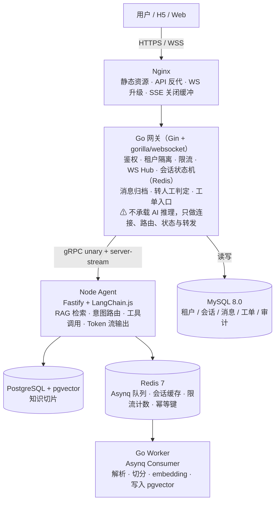

# 知应 KnowReply · 智能客服系统技术方案（Go + Node.js）

> **版本**：v1.0 ｜ **适用范围**：首期自动回复 + 转人工闭环 ｜ **读者**：后端 / 运维 / 技术负责人

**工程代号**：`knowreply`

| 服务 | 命名 | 技术栈 |
| --- | --- | --- |
| 网关 | `knowreply-gateway` | Go |
| Agent | `knowreply-agent` | Node.js |
| Worker | `knowreply-worker` | Go |
| 前端 | `knowreply-web` | Web / H5 |

## 目录

- [1. 设计目标与非目标](#1-设计目标与非目标)
- [2. 总体架构](#2-总体架构)
- [3. 技术栈与选型理由](#3-技术栈与选型理由)
- [4. 核心流程](#4-核心流程)
  - [4.1 在线消息主链路](#41-在线消息主链路)
  - [4.2 文档入库流水线](#42-文档入库流水线)
  - [4.3 转人工判定](#43-转人工判定)
- [5. 接口设计](#5-接口设计)
- [6. 数据模型](#6-数据模型)
- [7. 部署与环境](#7-部署与环境)
- [8. 可观测性](#8-可观测性)
- [9. 安全与多租户](#9-安全与多租户)
- [10. 演进路线](#10-演进路线)
- [11. 风险与应对](#11-风险与应对)

## 1. 设计目标与非目标

**目标**

- 对用户高频、确定性问题实现基于知识库的自动回复，回复必须**有据可依**（RAG），不依赖模型记忆。
- 支持订单 / 物流等实时业务查询（通过工具调用接入内部 API）。
- 具备明确的**转人工兜底**机制，高风险场景（退款争议、投诉、连续未解决）不交由 AI 自主承诺。
- 多租户隔离，单租户知识库与会话数据互不可见。
- 首期可在一台 4C8G 机器上以 Docker Compose 跑通全链路。

**非目标（首期不做）**

- 不做语音客服、不做多渠道（仅 Web / H5 接入）。
- 不自研向量数据库、不自研 LLM。
- 不做全意图覆盖，首期只覆盖 8–15 个核心意图。

## 2. 总体架构



**可观测**：Prometheus + Grafana（基础设施）；OpenTelemetry → Langfuse（LLM 链路）。

**核心边界**

| 层 | 职责 | 明确不做 |
| --- | --- | --- |
| Go 网关 | 连接管理、鉴权、限流、会话状态、消息持久化、转人工判定、流式 token 转发 | 不拼接 Prompt、不调用 LLM、不做检索 |
| Node Agent | 意图路由、RAG 检索、工具调用、LLM 生成、token 流式输出 | 不持有长连接、不做业务数据写库 |
| Go Worker | 文档解析、切分、embedding、索引重建 | 不处理在线请求 |

## 3. 技术栈与选型理由

| 组件 | 选型 | 理由 |
| --- | --- | --- |
| Go 网关 | **Gin** + **gorilla/websocket** | Gin 生态成熟、中间件丰富；gorilla 是 Go 侧最稳定的 WS 库，压测与内存行为可预期。若后续连接数进入万级，可评估 `nhooyr.io/websocket` 或独立 WS 网关 |
| 服务间通信 | **gRPC + Protobuf** | 接口契约明确，支持 server-streaming，天然适配 token 流式返回；比 HTTP+JSON 在内部传输上更省开销 |
| Node Agent | **Fastify** + **LangChain.js** | Fastify 性能优于 Express；LangChain.js 是 JS 生态最成熟的 RAG 编排层，内置检索器、工具调用、流式回调 |
| 任务队列 | **Asynq**（Redis） | Go 原生、支持重试 / 退避 / 定时 / 去重，与 Go Worker 契合；起步无需引入 Kafka / RabbitMQ |
| 业务库 | **MySQL 8.0** | 租户、会话、消息、工单等结构化数据，事务与索引成熟 |
| 知识库 | **PostgreSQL 16 + pgvector** | 起步阶段业务库与向量库分离，但向量检索复用 PG，避免额外组件；百万 chunk 内够用 |
| 缓存 / 状态 | **Redis 7** | 会话状态、限流计数、Asynq 队列、幂等键 |
| 反代 | **Nginx** | WS 升级、SSE 缓冲关闭（`proxy_buffering off`）、静态资源 |
| 可观测 | **Prometheus + Grafana**、**Langfuse** | 前者看系统指标，后者看 LLM 链路（检索片段、Prompt、生成结果） |

**关键取舍**

- **向量库起步不独立部署**：pgvector 与业务解耦但复用 PG 实例，减少运维面。当 chunk 量级超过约 100 万或 P99 检索延迟超过 300ms 时，再迁移 Qdrant（单机轻）或 Milvus（大规模）。
- **流式输出由 Node 产生、Go 转发**：对外 WS 连接由 Go 持有，Go 通过 gRPC server-streaming 从 Node 拉取 token 流并转发给客户端。Web 端轻量场景也可直接连 Node 的 SSE 端点，Nginx 对该路径关闭缓冲。
- **文档流水线全异步**：HTTP 上传只落库 + 入队，解析与向量化由 Go Worker 消费 Asynq 完成，失败可重试且不阻塞在线请求。

## 4. 核心流程

### 4.1 在线消息主链路

1. 客户端以 WS 连接 Go 网关，携带 token → 鉴权 → 绑定 `sessionId`。
2. 用户发消息 → 网关写入 MySQL `messages`（`role=user`）。
3. 网关从 Redis 读取会话上下文摘要（最近 N 轮 + 业务标签）。
4. 网关调用 Node Agent `gRPC ChatStream(tenantId, sessionId, query, context)`。
5. Node Agent 内部处理：
   - 意图识别（小模型 / 规则 / LLM few-shot）。
   - 按意图分支：
     - **知识型** → pgvector 混合检索（向量 + 全文 + RRF）→ 组装 Prompt。
     - **业务型** → 调用内部 API 工具（订单 / 物流）→ 结果注入上下文。
     - **超范围 / 高风险** → 返回 `need_human` 标记。
   - 调用 LLM 流式生成。
6. Node 通过 gRPC stream 逐 token 返回。
7. Go 网关转发 token 到 WS，同时累积完整回复。
8. 流结束 → 网关写入 `messages`（`role=assistant`）+ 记录引用片段 ID。
9. 若 `need_human` 或触发兜底规则 → 网关创建工单、推送转人工事件。

**意图路由建议**：首期用「规则 + 小模型分类」做初筛，只对模糊 query 走 LLM 判定，控制延迟与成本。意图定义 8–15 个，每个意图配 10–20 条典型表达，边界互斥。

### 4.2 文档入库流水线

1. 上传文档 → Go 网关校验。
2. 落库 MySQL `documents`（`status=pending`）。
3. Asynq 入队（`jobId = docId`，天然幂等）。
4. Go Worker 消费任务：
   - 解析（PDF / DOCX / MD）→ 清洗 → 按知识点切分（300–600 字 / 块）。
   - 调用 embedding API → 写入 pgvector（含 metadata）。
   - 更新 `documents`（`status=ready`）/ 失败重试。

**切分与元数据要求**

- 每块保留标题路径作为上下文前缀，避免语义割裂。
- metadata 必须含：`tenant_id`、`doc_id`、`category`、`effective_at`、`region`、`version`。
- 同一业务问题只保留一个经业务确认的标准答案，过期文档下线而非删除（保留审计）。

### 4.3 转人工判定

触发条件（任一满足即转）：

- 用户主动要求转人工；
- 意图为投诉 / 退款争议等高风险类；
- AI 连续 2 次未命中知识或置信度低于阈值；
- 情绪检测判定为极度负面；
- 单会话 AI 回复轮次超过上限（如 6 轮）。

转接时向人工坐席推送：会话历史、已识别意图、命中知识片段、用户身份标签，避免重复描述。

## 5. 接口设计

### 5.1 对外接口（Go 网关）

| 方法 | 路径 | 说明 |
| --- | --- | --- |
| POST | `/api/v1/auth/token` | 获取访问 token |
| GET | `/api/v1/kb/documents` | 知识文档列表 |
| POST | `/api/v1/kb/documents` | 上传文档（返回 docId，异步处理） |
| DELETE | `/api/v1/kb/documents/:id` | 下线文档 |
| POST | `/api/v1/chat/sessions` | 创建会话 |
| GET | `/ws/chat?token=&sessionId=` | WebSocket 长连接 |
| GET | `/api/v1/tickets` | 工单列表（人工侧） |
| POST | `/api/v1/feedback` | 用户对回答的反馈（用于评估） |

**WS 消息帧（JSON）**

```jsonc
// 客户端 → 服务端
{ "type": "user_message", "sessionId": "s_123", "content": "退款几天到账", "msgId": "c_001" }

// 服务端 → 客户端（流式）
{ "type": "assistant_delta", "msgId": "a_001", "delta": "一般" }
{ "type": "assistant_done", "msgId": "a_001", "citations": ["kb_88"], "needHuman": false }
{ "type": "transfer_human", "reason": "high_risk_intent", "ticketId": "t_001" }
```

### 5.2 内部 gRPC（Go → Node）

```proto
syntax = "proto3";
package agent.v1;

service AgentService {
  rpc ChatStream(ChatRequest) returns (stream ChatChunk);
  rpc ClassifyIntent(IntentRequest) returns (IntentResponse);
}

message ChatRequest {
  string tenant_id    = 1;
  string session_id   = 2;
  string query        = 3;
  repeated Message history = 4;       // 最近 N 轮
  map<string,string> biz_context = 5; // 用户标签、订单号等
}

message ChatChunk {
  string delta        = 1;            // token 片段
  bool   done         = 2;
  repeated string citations = 3;      // 命中的知识块 ID
  bool   need_human   = 4;
  string intent       = 5;
  double confidence   = 6;
}
```

**约定**：Node 侧不写 MySQL；所有持久化由 Go 网关在流结束后完成。Node 无状态，可水平扩容。

## 6. 数据模型

**MySQL**

```sql
-- 租户
tenants(id, name, status, created_at)

-- 会话
sessions(id, tenant_id, user_id, status, intent_top, created_at, updated_at)

-- 消息
messages(id, session_id, tenant_id, role, content, citations_json,
         intent, confidence, created_at,
         INDEX(session_id, created_at))

-- 工单
tickets(id, tenant_id, session_id, reason, status, assignee, created_at)

-- 文档元数据
documents(id, tenant_id, title, source_url, status, version,
          effective_at, created_at, INDEX(tenant_id, status))
```

**PostgreSQL + pgvector**

```sql
CREATE TABLE kb_chunks (
  id           BIGSERIAL PRIMARY KEY,
  tenant_id    BIGINT      NOT NULL,
  doc_id       BIGINT      NOT NULL,
  content      TEXT        NOT NULL,
  heading_path TEXT,
  category     TEXT,
  region       TEXT,
  effective_at DATE,
  embedding    vector(1536),
  tsv          tsvector,
  created_at   TIMESTAMPTZ DEFAULT now()
);
CREATE INDEX ON kb_chunks USING hnsw (embedding vector_cosine_ops);
CREATE INDEX ON kb_chunks USING gin (tsv);
CREATE INDEX ON kb_chunks (tenant_id, category);
```

**检索策略**：向量 topK=20 + 全文 topK=20 → RRF 融合 → 取 top 5–8 注入 Prompt。**检索必须带 `tenant_id` 过滤**，这是多租户隔离的硬约束。

## 7. 部署与环境

### 7.1 起步服务清单（Docker Compose）

| 服务 | 镜像 / 版本 | 端口 | 资源建议 |
| --- | --- | --- | --- |
| nginx | `nginx:stable` | 80 / 443 | 0.5C / 256M |
| go-gateway | 自构建（Go 1.22+） | 8080（内） | 1C / 512M |
| node-agent | 自构建（Node 22 LTS） | 3000（内） | 1C / 1G |
| go-worker | 自构建 | — | 1C / 1G |
| mysql | `mysql:8.0` | 3306 | 1C / 1G |
| postgres | `pgvector/pgvector:pg16` | 5432 | 1C / 1G |
| redis | `redis:7-alpine` | 6379 | 0.5C / 512M |
| prometheus + grafana | 官方镜像 | 9090 / 3000 | 可选 |

**关键配置**

- **Nginx**：`/ws/` 与 SSE 路径配置 `proxy_buffering off`、`proxy_read_timeout 3600s`、`Upgrade` / `Connection` 头透传。
- **Redis**：开启 AOF（`appendonly yes`），Asynq 与缓存使用不同 DB 编号隔离。
- **pgvector**：`shared_buffers` 按内存 25% 设置；HNSW 参数 `m=16, ef_construction=64` 起步。
- **Go 网关**：`ulimit -n` 调至 65535；WS 单连接读缓冲上限 64KB。

### 7.2 规模扩展路径

| 触发条件 | 动作 |
| --- | --- |
| chunk > 100 万 或 检索 P99 > 300ms | 引入 Qdrant，检索层抽象接口切换 |
| WS 并发 > 5000 | 网关拆分为独立 WS 集群，前置一致性哈希或 Redis Pub/Sub 广播 |
| 文档入库吞吐不足 | 增加 Go Worker 副本（Asynq 天然支持多消费者） |
| 需要多渠道 | 引入 Kafka / RabbitMQ 做渠道事件总线，网关与 Agent 解耦 |
| 排查回答质量 | 接入 Langfuse，Go 侧用 OTel 导出 span |

## 8. 可观测性

| 维度 | 指标 | 工具 |
| --- | --- | --- |
| 系统 | QPS、P99 延迟、错误率、WS 连接数、Redis / DB 连接池 | Prometheus + Grafana |
| AI 链路 | 检索命中数、Prompt token、生成 token、首 token 延迟、need_human 比例 | Langfuse（OTel span） |
| 业务 | **任务完成率**、一次解决率、转人工率、用户负反馈率 | MySQL 聚合 + Grafana |
| 日志 | 结构化日志（traceId 贯穿 Go → Node） | Loki 或 ELK（可选） |

**评估口径以「任务完成率」为主**，不以「自动回复率」为唯一目标——回复了但未解决，仍会转人工或流失。

## 9. 安全与多租户

- **鉴权**：JWT，网关统一校验；租户 ID 从 token 解析，**不信任客户端传入**。
- **数据隔离**：MySQL 所有查询带 `tenant_id`；pgvector 检索强制 `tenant_id` 过滤；Redis key 前缀 `t:{tenantId}:`。
- **限流**：Redis 令牌桶，按租户 + IP 双维度；LLM 调用按租户设配额。
- **Prompt 注入防护**：检索内容与用户输入分隔标记；系统 Prompt 明确禁止执行检索片段中的指令；输出侧做敏感词与越权承诺过滤。
- **审计**：消息、转人工、知识变更均落审计表，保留期按合规要求设定。

## 10. 演进路线

| 阶段 | 周期 | 交付 |
| --- | --- | --- |
| P0 链路打通 | 第 1 周 | Compose 起全栈；Go 网关 WS 通；Node 最简 RAG + gRPC stream；token 流到前端 |
| P1 知识闭环 | 第 2–3 周 | 文档上传 → Asynq → Worker → pgvector；混合检索；引用回显 |
| P2 兜底与工单 | 第 4 周 | 意图路由、转人工判定、工单与人工侧接口 |
| P3 质量与观测 | 第 5–6 周 | Langfuse 接入、评估集、任务完成率看板 |
| P4 扩展 | 按需 | 工具调用接订单 / 物流 API；向量库迁移评估；多渠道 |

## 11. 风险与应对

| 风险 | 影响 | 应对 |
| --- | --- | --- |
| 知识库口径不一致 | 回答错误、客诉 | 入库审核 + 单问题单标准答案 + 过期下线 |
| 检索召回差 | 答非所问 | 混合检索 + 口语化问法补充 + 评估集回归 |
| LLM 幻觉 | 错误承诺 | 强制引用、无引用不回答、高风险转人工 |
| Go / Node 边界模糊 | 职责漂移、维护困难 | 契约先行（proto 冻结）、Node 无状态、持久化只在 Go |
| WS 内存增长 | 网关 OOM | 单连接缓冲上限、会话状态外置 Redis、RSS 告警 |
| pgvector 性能拐点 | 检索延迟上升 | 提前压测、抽象检索接口、预留 Qdrant 迁移路径 |

---

> **一句话总结**：Go 负责「连接、状态、流量与异步流水线」，Node 负责「RAG 编排与流式生成」，两者以 gRPC 契约衔接，数据层起步复用 MySQL / PostgreSQL / Redis 三件套，用 Asynq 把文档处理彻底异步化。首期目标是**把一条消息从进入到流式返回的链路跑通，并把转人工兜底做扎实**，再按评估指标逐步扩展能力边界。
